

[Azure Database for PostgreSQL](https://learn.microsoft.com/azure/postgresql/) Flexible Server is a fully managed relational database service based on the open-source Postgres engine. It delivers predictable performance, built-in security, high availability, and dynamic scalability for mission-critical workloads. The Aspire Azure PostgreSQL EF Core integration lets you model an Azure PostgreSQL Flexible Server and its databases as first-class resources in your AppHost, then connect to them from C# consuming apps using Entity Framework Core.

## Why use Azure PostgreSQL with Aspire

Adding Azure PostgreSQL through Aspire — rather than wiring up connection strings and credentials by hand — gives you:

- **Zero-friction local development.** Aspire runs a local PostgreSQL container during development and automatically switches to Azure Database for PostgreSQL Flexible Server when you deploy — with no code changes.
- **Azure-native authentication.** The integration uses Microsoft Entra ID by default, so you never have to manage passwords in configuration files.
- **Consistent connection info.** Once you reference the database from a consuming app, Aspire injects connection properties as environment variables in a predictable format.
- **Built-in EF Core features.** C# apps get an automatically pooled `DbContext`, health checks, OpenTelemetry tracing, and metrics — all registered from a single `AddAzureNpgsqlDbContext` call.
- **Dashboard observability.** The database resource shows up in the Aspire dashboard with logs, status, and telemetry alongside your other services.

## How the pieces fit together

The Azure PostgreSQL EF Core integration has two sides: a **hosting integration** that you use in your AppHost to model the Azure PostgreSQL resource, and a **client integration** for C# consuming apps that reference it.

```mermaid
architecture-beta

  group apphost(server)[AppHost]
  group consumer(server)[Consuming app]

  service hosting(server)[Hosting integration] in apphost
  service postgres(logos:postgresql)[Azure PostgreSQL Flexible Server] in apphost
  service db(database)[postgresdb] in apphost

  service client(iconoir:server-connection)[EF Core client integration] in consumer
  service app(server)[App] in consumer

  hosting:R --> L:postgres
  postgres:R --> L:db
  db:R --> L:client
  client:R --> L:app
```

The **hosting integration** lives in your AppHost project and models the Azure PostgreSQL Flexible Server and databases as resources. The **EF Core client integration** lives in each C# consuming app and uses the connection information Aspire injects to interact with the database.

Getting there is a two-step process: model the Azure PostgreSQL resources in your AppHost, then connect to the database from each C# app that needs it.


1. ### Model Azure PostgreSQL in your AppHost

    Add the Azure PostgreSQL hosting integration to your AppHost, then declare an Azure PostgreSQL Flexible Server, one or more databases, and reference them from the apps that need to talk to the database. The [Azure PostgreSQL Hosting integration](/integrations/cloud/azure/azure-postgresql/azure-postgresql-host/) article walks through every capability — adding databases, configuring authentication, data volumes, and more.

    
Set up Azure PostgreSQL in the AppHost


2. ### Connect from your C# app using EF Core

    When you reference an Azure PostgreSQL database from a consuming app, Aspire injects its connection information as environment variables. See [Connect to Azure PostgreSQL with EF Core](/integrations/databases/efcore/azure-postgresql/azure-postgresql-connect/) for the connection properties reference and the full C# EF Core client integration — including `AddAzureNpgsqlDbContext`, enrichment, configuration, and telemetry.

    
Connect to Azure PostgreSQL with EF Core


