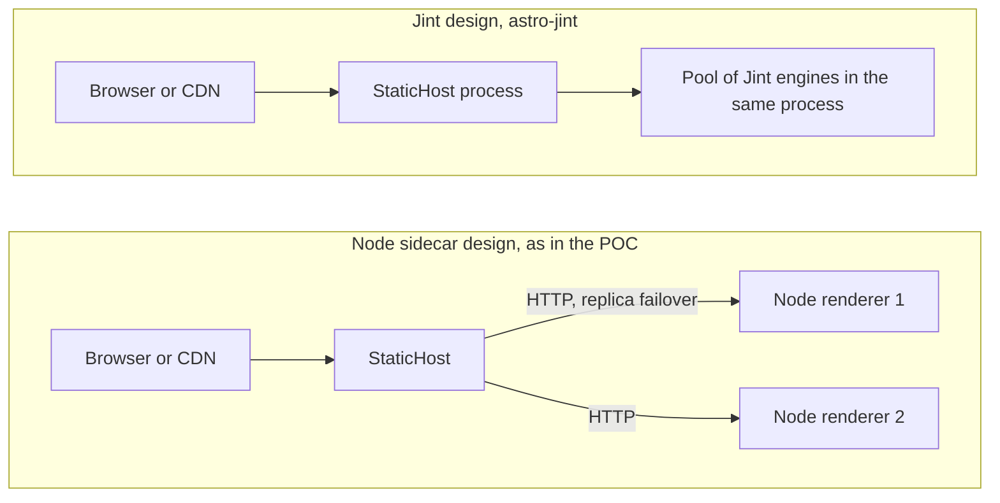
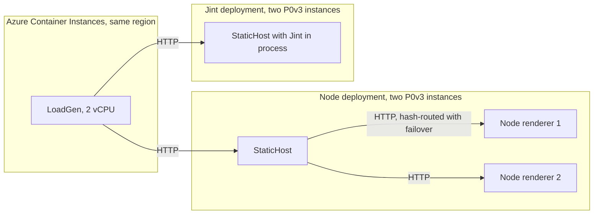

# Node sidecar versus Jint for the hybrid API reference

The hybrid API reference in [#1874](https://github.com/microsoft/aspire.dev/pull/1874) renders about 24,000 C# and TypeScript API pages on demand instead of building them. The POC renders them in Node sidecar processes behind StaticHost. This report measures the same pages on a second engine, [astro-jint](https://github.com/IEvangelist/astro-jint), which runs the Astro server bundle in [Jint](https://github.com/sebastienros/jint) inside ASP.NET Core and needs no Node at run time.

The first measurements run both engines on one workstation with the CPU budget pinned. The second set runs a complete deployment of each on Azure App Service, so StaticHost, the plan and the platform are included. It is described under [Production-like deployment on Azure](#production-like-deployment-on-azure).

[README.md](README.md) describes the harness and how to reproduce every number. The raw results are in [results/](results/).

## Verdict

Keep the Node sidecar. On the same pages, the same machine and the same CPU budget, Node renders 12 to 20 times as many HTML pages per second as Jint and, on one core, spends about 17 times less CPU on each page. It serves its first page after 1.3 s instead of 4.9 to 5.3 s, and its peak process memory is a quarter to a third of Jint's. The as-deployed Node renderer, which also runs Expressive Code, is still 7.6 to 12 times faster for HTML pages than the Jint build with code highlighting removed.

The Azure runs point the same way with a smaller gap. On two P0v3 instances of each deployment, Node served 8 to 10 times as many requests per second as Jint whenever most requests missed the cache. In the sweep that was 77 to 82 uncached API pages per second against 8.1 to 9.7. In a ten-minute soak over all 48,447 pages of the site it was 145 requests per second against 17.7, at 14 and 112 ms of instance CPU per request, with both plans at 100% CPU. The Jint plan used 90% of its memory on average and peaked at 94%, against 74% and 75% for Node. No request failed on either site. Jint was faster only when a request never reached the engine. On 50 hot pages it served 1,199 requests per second against 488, because its response cache sits in StaticHost and the Node cache sits behind an HTTP hop in each renderer. In the first sweep the Jint plan, with the same scale limit as the Node plan, grew from 2 instances to 10 while the Node plan stayed at 2.

Jint's advantages are operational. It needs no Node runtime and no `node_modules`, which is 425 MB less to ship. It runs inside the StaticHost process instead of in a sidecar, and it accepts connections after a quarter of a second. It rendered every sampled page identically to Node once build noise is normalized, and no run in this study produced an error. Those advantages do not offset a throughput gap of this size.

Two more findings count against Jint. The real site does not run in Jint as built: a WebAssembly reference, three Node built-ins and Expressive Code each have to be removed or replaced first. And one Jint engine needs a lot of memory. After four minutes of load it holds 1.1 to 1.2 GB of live heap and peaks at 2.4 to 2.5 GB of process memory. A one-hour crawl made 65,540 requests, which is 1.35 passes over the whole site. Over that crawl the engine held 1.3 to 1.4 GB of live heap and peaked at 3.0 GB of process memory on a machine with 31.7 GB of RAM. Node plain peaked at 0.7 GB in its crawl and Node as deployed at 1.0 GB.

One finding goes against the Node sidecar as deployed. In the crawl its live heap rose from 256 MB to 380 MB over 55,815 requests. After the first 6,500 requests the rise was a steady 1.9 MB per 1,000 requests with no sign of a plateau. The plain Node bundle stayed near 230 MB. The cause was not investigated. A straight line at that rate would reach the sidecar's 1,024 MB heap limit after roughly 335,000 to 395,000 more requests of the crawl mix. That figure is modeled and not observed. The details are under [Full-site crawl](#full-site-crawl).

## At a glance

| Measure | Node plain | Node as deployed | Jint plain |
|---|---:|---:|---:|
| Process ready for requests | 1.26-1.33 s | 2.14-2.96 s | 0.23-0.25 s |
| First page, from process start | 1.28-1.35 s | 2.16-2.99 s | 4.88-5.32 s |
| Median latency of one HTML page | 4.6-9.4 ms | 7.2-13.3 ms | 67-153 ms |
| HTML pages per second on one core | 144 | 88 | 8.3 |
| HTML pages per second on one core, 240 s soak | 146 | 87 | 8.8, or 11.0 tuned |
| CPU time per HTML page on one core | 6.7 ms | 10.9 ms | 116 ms |
| HTML pages per second on four cores | 454 | 287 | 33 |
| Markdown endpoints per second on one core | 3,020 | 2,993 | 404 |
| Peak process memory in the 240 s soak | 709 MB | 906 MB | 2,547 MB |
| Live heap after the 240 s soak | 227 MB | 351 MB | 1,170 MB |
| Live heap after a full-site crawl | 231 MB | 380 MB | 1,440 MB |
| Live heap growth in the crawl after request 6,500, per 1,000 requests | 0.11 MB | 1.85 MB | 1.67 MB |
| Peak process memory in the full-site crawl | 704 MB | 986 MB | 3,119 MB |
| Production `node_modules` to ship | 425 MB | 425 MB | none |
| The engine runs the real site unpatched | yes | yes | no |

Plain means the bundle is patched so that `<Code>` renders a plain `<pre><code>`. Both engines run the same patched page code, so the engine is the main variable. The Jint bundle also carries the two patches that let it load at all. Node also runs unpatched as the as-deployed reference, which Jint cannot do. The Node rows need the Node runtime on top of the 425 MB. Tuned adds three .NET runtime settings, described in [Jint runtime settings](#jint-runtime-settings). Figures are means of three runs where three exist. The three crawl rows come from one run per engine of 55,815 to 65,540 requests, described under [Full-site crawl](#full-site-crawl). Jint reports ready before its engines are warm, so the first-page row is the one to compare.

### On Azure

| Measure | Node sidecar | Jint in process |
|---|---:|---:|
| Median latency of an uncached API page | 26.6 ms | 102.3 ms |
| 99th percentile of an uncached API page | 146.9 ms | 1,996.1 ms |
| Median latency of a cached API page | 6.2 ms | 4.7 ms |
| Uncached API pages per second on two instances, 2 to 64 connections | 77-82 | 8.1-9.7 |
| Requests per second on 50 hot pages | 488 | 1,199 |
| Requests per second in the ten-minute soak | 144.9 | 17.7 |
| 99th percentile in the soak | 479 ms | 3,113 ms |
| Plan CPU in the soak, peak | 100% | 100% |
| Instance CPU time per request in the soak | 14 ms | 112 ms |
| Plan memory in the soak, mean and peak | 74% and 75% | 90% and 94% |
| Largest working set of one instance in the soak | 2,252 MB | 2,770 MB |
| Failed requests in any run | 0 | 0 |

Each site ran on two P0v3 instances and was loaded from inside the same region. The Jint site serves pages without syntax highlighting, so its figures are a lower bound on the cost of the real pages. The soak draws random pages from all 48,447 paths, half of them Markdown endpoints, so its CPU time per request is about half of the cost of an HTML page. The details are under [Production-like deployment on Azure](#production-like-deployment-on-azure).

## The two approaches

| | Node sidecar | Jint |
|---|---|---|
| Adapter | `@astrojs/node` 11.1.6 in middleware mode, mounted in a `node:http` server by `scripts/serve-api-docs.mjs` | `astro-adapter-jint` and `AstroJint.AspNetCore` from astro-jint at `3c4795c` |
| JavaScript engine | V8 with a JIT compiler | Jint 5.0.0-preview-2249, a tree-walking interpreter |
| Where pages render | Separate Node processes that StaticHost reaches over HTTP | An engine pool inside the ASP.NET Core process |
| Build switch | The default | `ASPIRE_HYBRID_ENGINE=jint` |
| Runtime requirements | Node 24 and the production `node_modules` | The .NET host only |

In the workstation runs both engines are driven at their own HTTP port by the same load generator. For Jint that port belongs to `JintHost`, a minimal ASP.NET Core host that calls `AddAstro()` and `UseAstro()`. It is not StaticHost. The proxy hop that the Node design adds, and that an in-process Jint design would remove, is part of neither workstation measurement. The Azure runs drive StaticHost itself, with each engine behind it.

## How the numbers were produced

| Aspect | Setting |
|---|---|
| Machine | Intel Core i7-14700K, 28 logical processors, 31.7 GB of RAM, Windows |
| Software | .NET SDK 10.0.402, Node 24.13.1 to run the renderers, Jint 5.0.0-preview-2249, astro-jint at `3c4795c` |
| Bundles | Node: the Windows artifact of CI run 38658562951 at `2f75c4432`. Jint: the Linux artifact of run 38818113616 at `43c5486ec`, which changes only build configuration, tests, the workflow and tools. The site sources, dependencies and lockfile are identical. |
| Pages | 24,205 HTML pages and 24,242 Markdown endpoints from the same `hybrid-api-docs.json` |
| Highlighting | Plain `<pre><code>` on both engines, with Node also measured as deployed |
| Load | One closed-loop load generator with the same headers, path files, seeds and statistics for both engines. Every run finished with zero errors. |
| CPU budget | The server is pinned to 1, 2 or 4 quiet logical processors and the load generator to two others. Node runs one renderer process per core. Jint runs one process with one engine per core. |
| Measured window | 30 s for Node and 45 s for Jint. Warm-up is 8 s for Node and 20 s for Jint, or 30 s on several cores. |
| Memory | Process memory is sampled every 200 ms during the load runs. The soak runs read the live heap after a forced full collection before and after the load. The growth and crawl runs also read it during the load, so they are not throughput measurements. |
| Repeats | Three runs of `c1-uniform-x16` on every bundle and of `c4-uniform-x32` on Node plain and Jint. One run of every other configuration. |
| Units | MB and GB are binary units, so 1 MB is 1,048,576 bytes. The CI build sizes are converted from byte counts. |

Figures that are described as modeled are arithmetic on measured rates, not measurements. The load configurations are named `c<cores>-<mix>-x<connections>`: for example `c1-uniform-x16` is one core, uniform page selection and 16 connections. This section describes the workstation runs. The Azure runs have their own setup under [Production-like deployment on Azure](#production-like-deployment-on-azure).

## Can the real pages run in Jint?

Not as built. The Jint build of the real site finishes, because astro-jint only warns about imports it cannot resolve, but the bundle does not load. The CI feasibility workflow `hybrid-api-docs-jint.yml` builds the site with `ASPIRE_HYBRID_ENGINE=jint` and reports 9 chunks that import Node built-ins. Four changes were needed before the host answered, each proven against the CI artifact.

| Blocker | Evidence | Change used here | A real fix |
|---|---|---|---|
| A top-level `WebAssembly` reference in the entry chunk | The entry chunk fails to load with `WebAssembly is not defined` | `--no-wasm` guards the reference | Keep Shiki's WebAssembly regex engine out of the on-demand bundle |
| Imports of `node:path`, `node:url` and `node:crypto` in `StarlightPage` and `FileTree` | Jint has no Node APIs | `--stub-node` replaces them with small stubs | Remove the imports from the render path |
| `<Code>` pulls in Expressive Code | `ec.config.mjs` imports `node:path`, `node:url`, `tsx/esm/api`, `expressive-code-twoslash` and `starlight-plugin-icons`, and Shiki needs WebAssembly | `--plain-code` renders `<pre><code>` | Pre-render code blocks at build time, or write a Jint-safe Expressive Code configuration |
| `Intl.DisplayNames` | The Markdown endpoints need ICU | `InvariantGlobalization=false` in the host | A host setting, nothing to change in the site |

The Jint bundle also loads a 45 MB API data layer into every engine, lazily, on the first page that reads the content collection. The import closure of an HTML page is 57 to 62 chunks and 3.8 MB. A Markdown endpoint needs 18 chunks and about 420 KB, and none of them import a Node built-in.

### Parity

`parity.mjs` renders 25 pages of each of the six HTML route kinds and 25 of each of the two Markdown kinds on both engines, using the plain builds. All 150 HTML pages match after build noise is normalized: the scoped `astro-xxxxxxxx` and `data-astro-cid-*` hashes, the `/_astro/` asset hashes and CRLF line endings. The line endings differ because the Node bundle was built on Windows and the Jint bundle on Linux. All 50 Markdown endpoints are byte-identical, and no status code differs. The only header differences are that Node sends `x-aspire-build-id` and `Vary: X-Aspire-Cache-Bypass`, and Jint sends neither.

The same script compared the two Azure deployments by URL, with 25 pages of each kind and 400 requests in all. Every request returned 200 on both sites. The 50 Markdown endpoints were byte-identical, and the content types, `cache-control`, `vary` and `link` headers had the same shape. Both sites sent `x-aspire-build-id`, with different values, and `x-astro-cache`. None of the 150 HTML pages matched, and that says nothing about the engines. The Node deployment was built from an older content commit than the Jint deployment, so the layout differs, and the Node pages carry Expressive Code markup where the Jint pages carry plain `<pre>` blocks. The workstation comparison above renders the same sources on both engines and is the valid HTML check.

## Build time and size

Both builds ran in the same workflow run on `ubuntu-latest` with 4 vCPUs, and both generated 8,281 pages.

| | Jint build | Node control build |
|---|---:|---:|
| Wall time | 13:08 | 14:12 |
| User CPU | 1,407 s | 1,608 s |
| Peak memory | 7.45 GB | 7.37 GB |
| Client output | 3.14 GB, 20,739 files | 3.06 GB, 21,173 files |
| Server output | 132.1 MB, 1,792 files | 125.6 MB, 1,776 files |

Each engine was built once, so the 64 s gap is a single sample. The POC's own workflow built the same Node hybrid output in 9:07 on `ubuntu-latest`, as the second build in a job that had already built the static site. That is five minutes faster than the Node control build here, so the time for one build can move by more than the gap between the engines. Build time does not separate the approaches on this evidence.

## Footprint on disk

| | Node sidecar | Jint |
|---|---:|---:|
| Production `node_modules` | 425.2 MB, 30,642 files | none |
| Host | The Node 24 runtime, not measured here | 5.2 MB, 13 files in the `JintHost` publish |

The server bundles are within about 5% of each other, as the build table shows. A StaticHost integration would add only the `AstroJint.AspNetCore`, `Jint` and `Acornima` assemblies, about 5 MB.

## Cold start

Each configuration was started three times as a fresh, unpinned process. Ready means the first successful health probe. The first page is the first C# type page, so its time includes everything a first request has to load.

| Bundle | Ready, ms | CPU s at ready | RSS MB at ready | First page, ms | All 8 route kinds, ms | CPU s after | RSS MB after |
|---|---:|---:|---:|---:|---:|---:|---:|
| Node plain | 1,264-1,329 | 1.4-1.5 | 466-467 | 1,284-1,347 | 470-499 | 1.6-1.8 | 491-493 |
| Node as deployed | 2,140-2,959 | 2.7-3.0 | 568 | 2,164-2,988 | 544-612 | 3.1-3.4 | 595-596 |
| Jint plain | 226-249 | 0.5-0.6 | 94-95 | 4,880-5,324 | 7,335-7,732 | 8.9-9.5 | 1,032-1,034 |

The first request to each route kind on a fresh process, in request order, in milliseconds:

| Route kind | Node plain | Node as deployed | Jint plain |
|---|---:|---:|---:|
| csharp-type, the first page | 17.6-20.4 | 24.4-29.4 | 4,653.7-5,074.5 |
| ts-module | 102.8-106.8 | 108.4-117.8 | 1,746.1-1,807.7 |
| ts-item | 11.6-12.3 | 62.7-69.2 | 134.4-148.4 |
| ts-member | 9.5-10.1 | 14.7-24.1 | 87.2-88.5 |
| csharp-package | 11.1-13.0 | 14.4-15.6 | 102.3-115.8 |
| csharp-memberkind | 13.2-14.5 | 21.5-26.7 | 190.5-211.4 |
| csharp-md | 5.1-5.8 | 5.1-6.8 | 17.9-19.6 |
| ts-md | 4.6-5.7 | 4.1-4.6 | 6.5-7.2 |

Jint is ready in about a quarter of a second because it creates its engines in the background and loads nothing else up front. The first page then pays for the lazy load of the 45 MB data layer into the engine and for the rest of the module graph. The first C# page took 4.7 to 5.1 s. The first TypeScript module page took a further 1.7 to 1.8 s, and the first request to each other HTML route kind took 0.09 to 0.21 s. After the first request to all eight route kinds, the Jint process had used 8.9 to 9.5 CPU seconds and held 1,032 to 1,034 MB, against 1.6 to 1.8 CPU seconds and 491 to 493 MB for Node plain.

Node as deployed is ready after 2.1 to 3.0 s, about twice as late as Node plain. The most likely cause is the Expressive Code and Shiki modules that the plain build removes, which the readiness check has to load. This was not measured separately.

The cold-start runs were not pinned. In the 240 s soaks, which pin the server to one core, the first page took 7.9 s on Jint with default settings and 4.3 s with the tuned settings, against 20 to 31 ms on Node. A host that restarts on one core needs a warm-up request before it takes traffic.

## Latency of one request

One connection, one request at a time, cache bypassed. Each route kind uses 25 pages that are requested three times in a row after a warm-up, and the table shows the median of the repeat requests, in milliseconds. The Node renderer has a small in-memory response cache, which `X-Aspire-Cache-Bypass: 1` turns off. The cached columns show what a hit costs. The Jint host ignores the header and does not cache rendered pages.

| Route kind | Node plain | Node plain, cached | Node as deployed | Node as deployed, cached | Jint plain | Jint / Node plain |
|---|---:|---:|---:|---:|---:|---:|
| csharp-package | 6.05 | 0.56 | 8.55 | 0.60 | 110.63 | 18x |
| csharp-type | 7.59 | 0.61 | 12.11 | 0.67 | 146.89 | 19x |
| csharp-memberkind | 9.38 | 0.55 | 13.29 | 0.69 | 153.04 | 16x |
| ts-module | 5.04 | 0.45 | 7.17 | 0.48 | 67.89 | 13x |
| ts-item | 4.71 | 0.41 | 8.28 | 0.47 | 69.13 | 15x |
| ts-member | 4.58 | 0.37 | 8.35 | 0.40 | 66.98 | 15x |
| csharp-md | 0.41 | 0.22 | 0.40 | 0.22 | 1.32 | 3.2x |
| ts-md | 0.33 | 0.20 | 0.31 | 0.22 | 0.97 | 2.9x |

HTML pages are 175 to 260 KB on plain builds and 186 to 288 KB as deployed. Markdown endpoints are 1 to 2 KB. On every route kind and for all three bundles the median first request is within 20% of the median repeat, so no per-page warm-up cost shows in serial latency. The slowest first HTML request of the 25 pages is 2.7 to 3.5 times the repeat median on Node plain and 1.3 to 3.7 times on Jint. In absolute terms it is 16 to 28 ms on Node plain and 90 to 571 ms on Jint, where the 571 ms was a member-kind page against a repeat median of 153 ms.

## Throughput

Closed-loop load on a pinned server. Each cell is one run, and the [variance table](#run-to-run-variance) shows the repeats.

| Configuration | Node plain, rps | Node as deployed, rps | Jint plain, rps | Node plain / Jint | Node as deployed / Jint |
|---|---:|---:|---:|---:|---:|
| c1-uniform-x1 | 142.5 | 86.9 | 7.9 | 18x | 11x |
| c1-uniform-x4 | 144.6 | 88.9 | 7.2 | 20x | 12x |
| c1-uniform-x16 | 144.0 | 88.2 | 8.3 | 17x | 11x |
| c1-zipf-x16 | 142.3 | 86.7 | 7.9 | 18x | 11x |
| c2-uniform-x16 | 265.2 | 162.4 | 21.4 | 12x | 7.6x |
| c4-uniform-x32 | 451.3 | 287.1 | 32.3 | 14x | 8.9x |
| c1-md-x16 | 3,020.5 | 2,993.3 | 404.2 | 7.5x | 7.4x |

CPU time per request, in milliseconds, from the process's own CPU counter:

| Configuration | Node plain | Node as deployed | Jint plain |
|---|---:|---:|---:|
| c1-uniform-x1 | 6.66 | 10.84 | 121.82 |
| c1-uniform-x4 | 6.64 | 10.87 | 132.62 |
| c1-uniform-x16 | 6.67 | 10.70 | 114.88 |
| c1-zipf-x16 | 6.80 | 11.10 | 122.04 |
| c2-uniform-x16 | 7.31 | 11.90 | 89.10 |
| c4-uniform-x32 | 8.58 | 13.48 | 113.35 |
| c1-md-x16 | 0.31 | 0.32 | 2.37 |

Latency under load, in milliseconds. At 16 connections on one core the latency is queueing time: 16 connections times the CPU time per page gives about 107 ms for Node plain and 1.8 s for Jint, which is near the p50 values in the table.

| Configuration | Bundle | Requests | Server cores used | p50 | p90 | p99 | p99.9 |
|---|---|---:|---:|---:|---:|---:|---:|
| c1-uniform-x1 | Node plain | 4,276 | 0.95 | 4 | 16 | 38 | 101 |
| c1-uniform-x1 | Node as deployed | 2,608 | 0.94 | 8 | 18 | 35 | 143 |
| c1-uniform-x1 | Jint plain | 354 | 0.95 | 89 | 197 | 721 | 1,541 |
| c1-uniform-x16 | Node plain | 4,320 | 0.96 | 107 | 184 | 283 | 385 |
| c1-uniform-x16 | Node as deployed | 2,647 | 0.94 | 184 | 291 | 397 | 442 |
| c1-uniform-x16 | Jint plain | 375 | 0.96 | 1,638 | 2,851 | 3,736 | 3,742 |
| c4-uniform-x32 | Node plain | 13,540 | 3.86 | 48 | 166 | 344 | 463 |
| c4-uniform-x32 | Node as deployed | 8,614 | 3.87 | 77 | 270 | 520 | 664 |
| c4-uniform-x32 | Jint plain | 1,455 | 3.66 | 926 | 1,376 | 1,966 | 2,228 |

What the tables show:

- Throughput is flat from 1 to 16 connections on one core, because one connection already keeps the core busy. The server used 0.94 to 0.97 of a core in every one-core run, so the CPU budget was honored.
- Jint, with one engine per core and server GC, scaled from 8.3 to 32.6 rps on four cores, which is 3.9 times for four times the cores. Node, with one process per core, scaled from 144 to 454 rps, 3.1 times. Scaling out narrows the ratio from 17x to 14x and does not close it.
- Skewed popularity, the zipf mix, changes nothing on either engine, because neither caches when the bypass header is set.
- Jint does 404 Markdown requests per second against 3,020 for Node. The Markdown endpoints are the cheapest route kind, and Jint is still 7.5 times behind.
- The tails have a similar shape on all three bundles. At 16 connections p99 is 2.2 to 2.6 times the p50, and at one connection it is 4 to 10 times. Jint's p99 is 19 times Node plain's at one connection, 13 times at 16 connections and 5.7 times on four cores.

The Node renderer's LRU cache raises the one-core zipf rate from 142 to 220 rps on plain and from 87 to 137 on as deployed, which is 54% and 58%, and a hit costs 0.2 to 0.7 ms. That is a property of the cache, not of the engine. The same cache could sit in StaticHost or a CDN in front of either engine.

## Soak runs

Each soak runs 240 s on one pinned core with 16 connections and a uniform page mix, after one warm-up page. The live heap is read with a forced full collection before and after.

| | Node plain | Node as deployed | Jint plain, default | Jint plain, tuned |
|---|---:|---:|---:|---:|
| Requests | 35,119 | 20,790 | 2,113 | 2,643 |
| Pages per second | 146.3 | 86.6 | 8.8 | 11.0 |
| Server cores used | 0.97 | 0.96 | 0.96 | 0.96 |
| CPU ms per request | 6.64 | 11.14 | 109.2 | 87.2 |
| Latency mean, ms | 109 | 185 | 1,825 | 1,458 |
| Latency p50, ms | 105 | 176 | 1,704 | 1,409 |
| Latency p99, ms | 262 | 446 | 3,834 | 2,458 |
| Latency p99.9, ms | 336 | 705 | 4,260 | 2,949 |
| Latency max, ms | 471 | 1,133 | 4,345 | 2,964 |
| RSS start to end, MB | 410 to 697 | 487 to 897 | 956 to 2,348 | 1,069 to 2,264 |
| Peak RSS, MB | 709 | 906 | 2,547 | 2,493 |
| Live heap before to after, MB | 204 to 227 | 256 to 351 | 767 to 1,170 | 784 to 1,227 |
| Committed heap after, MB | 233 | 372 | 2,133 | 1,993 |
| First page, ms | 21 | 31 | 7,917 | 4,259 |

Node plain climbs from 132 rps in the first 15 s to 144 rps from 15 to 60 s and 148 to 152 rps from 120 s onward, most likely as V8's tiering settles. An earlier run of the same soak gave 139.2 rps. The machine was not quiet for part of that run, so the table uses the clean rerun. Node as deployed is flat: 86.0 rps in the first 60 s and 86.8 after.

Jint with default settings ramps for about 75 s. It ran at 6.8 rps in the first 60 s, with 142.2 CPU ms per request and 24.4% of the time in GC pauses, then at 9.5 rps from 60 to 240 s, with 101.2 CPU ms per request and 21.8% in GC pauses. The .NET JIT compiled 2,300 to 2,900 methods in each of the first four 15 s windows, about 390 in the fifth and fewer than 150 per window after that. The 45 s load runs for Jint therefore include the ramp and understate its steady rate by about 13%. The tuned settings remove the ramp: Jint runs at 11.0 rps from the first minute to the end, and the first 60 s and the last 180 s differ by under 2%.

Against Node's clean 146.3 rps, Jint's steady rate of 9.5 rps is 15 times lower and the tuned 11.0 rps is 13 times lower. Against Node as deployed at 86.6 rps, they are 9 times and 8 times lower.

## Memory

Process memory during the load runs, in MB, from the first to the last sample of the measured window, with the peak:

| Configuration | Node plain | Node as deployed | Jint plain |
|---|---:|---:|---:|
| c1-uniform-x16 | 711 to 723, peak 723 | 792 to 835, peak 838 | 1,458 to 1,926, peak 2,136 |
| c1-md-x16 | 667 to 673, peak 678 | 765 to 790, peak 794 | 962 to 1,001, peak 1,001 |
| c2-uniform-x16 | 1,633 to 1,638, peak 1,660 | 1,658 to 1,710, peak 1,716 | 2,967 to 3,624, peak 3,710 |
| c4-uniform-x32 | 2,932 to 3,008, peak 3,029 | 3,378 to 3,548, peak 3,550 | 4,766 to 4,967, peak 5,213 |

On one core, Node plain stays near 0.7 GB and Node as deployed near 0.8 GB. Neither grows by more than about 45 MB in its 30 s window. Jint starts near 1.4 GB after its warm-up and grows by 0.3 to 0.5 GB in its 45 s window. At four cores the four Node plain processes together use 2.9 GB, and the one Jint process with four engines uses 4.7 to 4.9 GB.

The live heap is the memory the managed heap keeps after a forced full collection. Node reports V8's heap after `HeapProfiler.collectGarbage`, and Jint reports the bytes promoted by a blocking, compacting .NET collection. They do not count the same things, so use the RSS columns for a like-for-like comparison.

### Does the live heap keep growing?

Three probes on one pinned core, with a forced full collection every 30 s. Each request is drawn at random from a pool of 13,682 pages, so the number of distinct pages visited is lower than the number of requests. The distinct counts are expected values computed from the path file.

| Probe | Requests | Distinct pages | Live heap at start | Live heap at end | Reading |
|---|---:|---:|---:|---:|---|
| Jint, distinct pages | 2,648 | about 2,360 | 767 MB | 1,214 MB | 260 MB in the first 152 requests, then 187 MB over about 2,200 new pages, or about 0.085 MB per new page, with 20 to 50 MB of jitter between samples |
| Jint, replay of 40 pages | 1,264 | 40 | 784 MB | 881 MB | Between 881 and 917 MB after the first pass |
| Node plain, distinct pages | 42,969 | about 12,600 | 204 MB | 227 MB | Within 225 to 227 MB from request 4,045 |

The Jint replay stays flat, so the growth is tied to visiting new pages and is not a leak per request. The cause is not identified. The full-site crawl below visits all 24,205 pages, and after one pass the live heap was 1,377 MB.

### Full-site crawl

A crawl requests every HTML page and every Markdown endpoint once. That is 48,447 requests. They go out in the order of the path file over a single connection, and the crawl starts again at the end. Each engine ran it on one pinned core with the renderer cache bypassed. A forced full collection read the live heap about every 15 s on Node and about every 2 minutes on Jint. The runs lasted 240 s for Node plain, 360 s for Node as deployed and 3,600 s for Jint, which gave each engine 1.15 to 1.35 passes over the site. Half of the requests are Markdown endpoints, which cost far less than HTML pages, so the rates and latencies here are not comparable with the HTML-only figures elsewhere in this report. Each engine ran the crawl once. The live heap rows are for the trend within one engine, and the RSS rows are the ones to compare between engines.

| Measure | Node plain | Node as deployed | Jint plain |
|---|---:|---:|---:|
| Run length | 240 s | 360 s | 3,600 s |
| Requests | 59,074 | 55,815 | 65,540 |
| Passes over the site | 1.22 | 1.15 | 1.35 |
| Requests per second | 246 | 155 | 18.2 |
| Server cores in use | 0.94 | 0.94 | 0.95 |
| CPU time per request | 3.82 ms | 6.06 ms | 52.25 ms |
| Latency, 99th percentile | 28 ms | 32 ms | 467 ms |
| Latency, slowest request | 211 ms | 419 ms | 2,115 ms |
| Errors | 0 | 0 | 0 |
| Live heap before the load | 204 MB | 256 MB | 784 MB |
| Live heap after one pass | 231 MB | 370 MB | 1,377 MB |
| Live heap after the last request | 231 MB | 380 MB | 1,440 MB |
| Committed heap after the last request | 236 MB | 386 MB | 2,098 MB |
| RSS after the last forced collection | 416 MB | 620 MB | 2,206 MB |
| Peak RSS sampled during the load | 704 MB | 986 MB | 3,119 MB |
| Live heap slope after request 6,500, per 1,000 requests | 0.11 MB | 1.85 MB | 1.67 MB |

The reading after one pass is the forced collection nearest to request 48,447. The slope is a least-squares fit to the readings taken during the load after request 6,500. Its standard error is 0.01 for both Node bundles and 0.34 for Jint, and the readings scatter around the line by 0.4 MB on both Node bundles and by 30 MB on Jint.

Node plain is flat. After the first 6,500 requests its live heap stayed between 226 and 232 MB to the end of the run.

Node as deployed keeps rising. After the first 6,500 requests its live heap follows a straight line. The slope was 1.92, 1.86 and 1.64 MB per 1,000 requests over requests 2,000 to 24,000, 24,000 to 48,000 and 48,000 to the end, so the rate eased by about 15% and the data show no plateau. The two Node bundles differ only in how `<Code>` renders, so the extra growth appears only when Expressive Code highlights the code blocks. The mechanism was not investigated.

Extending that line gives a modeled estimate. At 1.64 to 1.92 MB per 1,000 requests the live heap would reach the 1,024 MB limit of `--max-old-space-size=1024` after roughly 335,000 to 395,000 more requests of this mix, which is about 4 days at 1 request per second and about 10 hours at 10 requests per second. V8 needs headroom above the live heap, so a failure would come sooner. A restart or a deploy resets the heap. The crawl bypasses the renderer's LRU cache, and a cache hit does not render, so a deployment renders fewer pages than it serves. The crawl does not show whether the rise levels off. A long run of the as-deployed renderer is the way to find out.

Jint's live heap climbed from 784 MB to 1,312 MB during the first 6,500 requests, which is 0.13 of a pass. After that the readings stayed between 1,301 and 1,438 MB for the other 59,000 requests. The fit gives a rise of 1.67 MB per 1,000 requests with a standard error of 0.34. The slope from request 48,000 on is lower at 0.41 MB per 1,000 requests, but the readings scatter by about 30 MB around the line, so the crawl cannot say whether the live heap levels off. Committed memory ranged from 1,965 to 2,612 MB and RSS after each forced collection from 2,072 to 2,721 MB. For planning, one Jint engine on one core needed 2.0 to 2.7 GB of RSS after a collection and peaked at 3.0 GB. No request failed.

On this mix Node plain serves 13.5 times and Node as deployed 8.5 times as many requests per second as Jint, and Node plain spends 3.82 ms of CPU per request against 52.25 ms. A half-and-half mix should land between the ratios of its two halves, and it does. The Markdown-only and HTML-only runs give 7.5 and 17 times for Node plain and 7.4 and 10.6 times for Node as deployed.

## Garbage collection and the JIT

Jint allocates about 32 to 35 MB for each HTML page, about 160 times the size of the response, and about 0.4 MB for each Markdown endpoint. With default settings and one core it spent 21 to 22% of the wall time paused in the garbage collector and ran about 1.8 to 2 collections per page.

| Configuration | GC pause, % of wall time | All GCs | Gen1 and above | Gen2 | Allocated MB per request |
|---|---:|---:|---:|---:|---:|
| c1-uniform-x1 | 21.3 | 642 | 290 | 3 | 32.4 |
| c1-uniform-x4 | 21.0 | 644 | 285 | 3 | 35.5 |
| c1-uniform-x16 | 22.0 | 678 | 298 | 3 | 32.3 |
| c1-zipf-x16 | 20.7 | 672 | 299 | 3 | 33.9 |
| c1-md-x16 | 40.2 | 451 | 6 | 0 | 0.4 |
| c2-uniform-x16, server GC | 10.3 | 97 | 41 | 3 | 34.0 |
| c4-uniform-x32, server GC | 20.0 | 151 | 65 | 9 | 34.5 |
| c4-uniform-x32, workstation GC | 81.7 | 652 | 311 | 2 | 32.0 |

The first count column is every collection, because .NET includes a collection of a higher generation in each lower generation's count. On one core .NET runs the workstation collector, and the table shows what server GC does at two and four cores. With four engines the workstation collector spent 81.7% of the time paused, so the multi-core runs use server GC. astro-jint's documentation recommends server GC for pools above about eight engines, and this run shows the same effect at four. In the Markdown run each collection paused for about 40 ms on average, against about 15 ms in the HTML runs. The cause is not identified.

Node's garbage collector costs far less. In the V8 profile runs, which were unpinned and had the profiler attached, the pauses were 7.1% of wall time on plain and 4.6% as deployed, with 247 scavenges and 17 major collections in 20 s on plain.

The one-hour crawl shows that Jint's collection cost holds over time. The pause share stayed between 23.6% and 26.5% in every five-minute window and was 25.4% over the whole run. The process allocated 16.6 MB per request, which fits an even mix of HTML pages at about 32 MB and Markdown endpoints at about 0.4 MB. The .NET JIT compiled 11,059 methods in the first five minutes, 504 in the next five and 216 in the five after that, and 39 or fewer in every five-minute window from 900 s on.

## Jint runtime settings

Five .NET settings were tried one at a time on one core with 16 connections, for 45 s after a 20 s warm-up, and then the three that helped most were tried together. They are environment variables of the host process, so the code does not change.

| Setting | Requests | rps | vs default | rps of the last third | CPU ms/request | GC pause % | All GCs / gen1 and above / gen2 | Allocated MB per request | RSS peak MB |
|---|---:|---:|---:|---:|---:|---:|---:|---:|---:|
| default | 374 | 8.3 | 0.0% | 10.3 | 118.0 | 21.5 | 674 / 300 / 3 | 32.2 | 2,119 |
| `DOTNET_gcConcurrent=0` | 433 | 9.6 | +15.7% | 11.9 | 100.6 | 12.9 | 141 / 31 / 2 | 31.3 | 2,156 |
| `DOTNET_GCgen0size=10000000`, 256 MiB | 449 | 10.0 | +20.5% | 12.3 | 96.6 | 14.0 | 188 / 127 / 2 | 31.0 | 2,300 |
| `DOTNET_TieredPGO=0` | 386 | 8.6 | +3.6% | 9.3 | 113.0 | 20.5 | 686 / 302 / 3 | 31.7 | 2,188 |
| `DOTNET_TC_CallCountingDelayMs=0` | 456 | 10.1 | +21.7% | 10.3 | 94.6 | 22.5 | 806 / 356 / 4 | 31.5 | 2,303 |
| `DOTNET_TieredCompilation=0` | 393 | 8.7 | +4.8% | 9.1 | 110.9 | 19.5 | 693 / 309 / 3 | 31.5 | 2,156 |
| the three settings together | 525 | 11.7 | +41.0% | 10.7 | 82.8 | 15.5 | 161 / 51 / 3 | 31.7 | 2,221 |

The last row combines `DOTNET_TC_CallCountingDelayMs=0`, `DOTNET_gcConcurrent=0` and `DOTNET_GCgen0size=10000000`. The two GC settings cut the total GC count by 3.6 to 4.8 times and the pause share from 21.5% to 13 or 14%. `TC_CallCountingDelayMs=0` shortens the JIT ramp. The gain is not additive once the ramp is over: the combined run's last-third rate of 10.7 rps is no higher than the single GC settings' 11.9 and 12.3. The default row is a fourth run of the default configuration, taken in the same batch as the settings, and the four default runs gave 8.1 to 8.4 rps. `TieredPGO=0` and `TieredCompilation=0` moved the rate by less than 5%, which is close to that spread, so this study does not count them as improvements. Each row is a single 45 s run with a window noise of about 1 rps.

The same three settings made four cores worse. On `c4-uniform-x32`, with server GC, 32 connections and 45 s after a 30 s warm-up:

| Setting | Runs | Requests | rps | CPU ms/request | GC pause % | All GCs / gen1 and above / gen2 | RSS peak MB |
|---|---:|---:|---:|---:|---:|---|---:|
| default | 3 | 1,470 | 32.6 | 114.4 | 19.4 | 151 / 65 / 9, 157 / 68 / 10, 153 / 67 / 12 | 5,029 |
| the three settings together | 1 | 1,216 | 27.0 | 139.7 | 37.2 | 125 / 51 / 9 | 4,629 |

That is 17% fewer pages per second and nearly twice the GC pause share. The cause is unknown, and it is one run against three. The tuned settings are a candidate for one core only.

The best Jint result on one core is 11.7 rps with the three settings together, 12 times slower than Node plain's 144 rps. On four cores the best is the default's 32.6 rps, 14 times slower than 454 rps, because the tuned four-core run, at 27.0 rps, was worse.

## Where the time goes

### Node, V8 CPU profile

Sixteen connections for 20 s with the profiler attached, unpinned. The profile runs reached 166.6 rps on plain and 100.4 rps as deployed, which is more than the pinned runs, most likely because V8's garbage collection and compiler threads ran on other cores. Self time is attributed to the source module that owns each frame's line, read from the `//#region` markers that the bundler writes into every chunk.

| Region | Node plain | Node as deployed |
|---|---:|---:|
| Astro render pipeline | 37.9% | 23.2% |
| Libraries: zod, hast, devalue and others | 15.5% | 12.5% |
| Starlight: page chrome, routes, i18n | 12.1% | 8.9% |
| V8 builtins and native | 9.8% | 7.1% |
| Node internals: http, streams, fs, url | 8.4% | 5.4% |
| V8 garbage collection | 7.5% | 5.1% |
| Site: Starlight overrides and shared components | 4.0% | 2.5% |
| Site: API reference pages, components, data helpers | 2.0% | 1.2% |
| Syntax highlighting: Expressive Code, Shiki, PostCSS | 0.1% | 16.0% |
| WebAssembly: Shiki's Oniguruma regex engine | none | 14.5% |
| Other: idle, native, unattributed | 2.9% | 3.6% |

| Measure | Node plain | Node as deployed |
|---|---:|---:|
| Requests per second under the profiler | 166.6 | 100.4 |
| Event-loop utilization | 0.986 | 0.992 |
| GC pause, % of wall time | 7.07 | 4.61 |
| Heap used, MB | 256 | 443 |
| RSS, MB | 741 | 868 |

- Expressive Code, Shiki and its WebAssembly module take about 30% of the as-deployed CPU. That accounts for most of the 4.1 ms difference in CPU per page, 10.9 ms as deployed against 6.7 ms on plain.
- The site's own API reference code is 2% of the plain CPU. The cost is in the framework: Astro's render pipeline, the libraries it pulls in and Starlight's page chrome add up to about 65%.
- By package on plain, `astro` takes 37.6%, `@astrojs/starlight` 11.5%, `zod` 9.8% and `i18next` 3.8%. As deployed, `astro` takes 23%, `@astrojs/starlight` 8.4%, `@expressive-code/core` 7.7% and `zod` 6%.
- The event loop is saturated, at 0.986 and 0.992 utilization, so a single renderer cannot do more work per core.

### Jint, .NET trace

`dotnet-trace` collected `dotnet-sampled-thread-time` for 40 s, starting 75 s into a load run on the default configuration with one pinned core and 16 connections. The load run served 1,179 requests at 8.7 rps with no errors. The converter is TraceEvent 3.1.23.0, and `analyze-nettrace.mjs` aggregates the result. The engine profile is every sample whose stack holds a `Jint` or `Acornima` frame.

Engine frames are on the stack for 99.9% of the 39,955 ms window, 99.2% of that time in managed code and 0.8% in unmanaged code. The other 11 threads were almost entirely idle waits. Self time by namespace, as a share of the engine samples:

| Namespace | Role | Share |
|---|---|---:|
| `Jint.Runtime.Interpreter.Expressions` | Evaluating expressions | 27.1% |
| `System.Threading` | Waiting for a collection to finish | 20.0% |
| `Jint.Runtime.Interpreter` | Running statement lists | 8.2% |
| `Jint.Runtime.Interpreter.Statements` | Running statements | 7.2% |
| `Jint.Native.Object` | JavaScript objects | 6.1% |
| `Jint` | Engine core | 5.1% |
| `Jint.Native.Function` | JavaScript function calls | 4.3% |
| `Jint.Collections` | Jint's own collection types | 3.4% |
| `System.Runtime.CompilerServices` | Runtime helpers | 3.3% |
| `Jint.Runtime.Environments` | Scopes and bindings | 3.3% |
| `System` | Base class library | 2.5% |
| `Jint.Native.Array` | JavaScript arrays | 2.4% |
| `Jint.Native.RegExp` | JavaScript regular expressions | 1.4% |
| 22 other namespaces | None above 0.8% | 5.6% |

The `Jint` and `Acornima` namespaces together take 72.8% of the engine samples and the `System` namespaces 26.8%, of which the collection wait is 20.0 points. Code that the .NET regular-expression compiler generated takes 0.4%. The tree-walking interpreter, which is the three `Jint.Runtime.Interpreter` namespaces, takes 42.6%. Acornima, the parser, takes 0.14%, so parsing is negligible once the modules are loaded.

The hottest functions by self time are `Thread.PollGCWorker` at 19.9%, `JintStatementList.Execute` at 7.9%, `JintIdentifierExpression.GetValue` at 4.9%, `JintCallExpression.RegisterLaneCall` at 4.3% and `JintCallExpression.EvaluateInternal` at 3.1%. `PollGCWorker` is where a managed thread waits at a garbage-collection poll while the runtime holds it for a collection. It accounts for almost all of the `System.Threading` share, and it is close to the 21 to 22% GC pause that the load runs report for the same configuration, so the two are consistent. Per-statement checks cost 2.3% and the memory-limit check 0.7%, so the host's limit is not a cost that matters.

Jint is a tree-walking interpreter, and the collector takes another fifth of the time. About 43% of the samples are interpreter dispatch, and 20% is waiting for collections, which the 32 MB allocated for each page triggers. No `AstroJint` frame appears among the frames with a self share of 0.09% or more, so the host's own code is below what this profile can see. astro-jint's README gives 0.8 to 0.9 ms for a warm tiny page, which suggests that the cost here is the volume of JavaScript in these pages and not the host. This study did not run that sample.

The sampler is wall-clock at about 100 Hz. It sees .NET frames and cannot name the JavaScript functions that Jint is running, and the idle thread-pool waits that it marks as CPU time are not real CPU. Use the shares for the engine thread and not the absolute times.

## Run-to-run variance

| Bundle | Configuration | Runs | rps per run | Mean rps | Spread, max-min over mean | CPU ms/request per run |
|---|---|---:|---|---:|---:|---|
| Node plain | c1-uniform-x16 | 3 | 144.0, 143.3, 145.4 | 144.2 | 1.5% | 6.67, 6.79, 6.78 |
| Node plain | c4-uniform-x32 | 3 | 451.3, 450.6, 460.5 | 454.1 | 2.2% | 8.58, 8.73, 8.53 |
| Node as deployed | c1-uniform-x16 | 3 | 88.2, 88.7, 88.1 | 88.3 | 0.7% | 10.70, 10.92, 11.03 |
| Jint plain | c1-uniform-x16 | 3 | 8.3, 8.1, 8.4 | 8.3 | 3.6% | 114.88, 117.60, 115.53 |
| Jint plain | c4-uniform-x32 | 3 | 32.3, 33.3, 32.3 | 32.6 | 3.1% | 113.35, 112.61, 117.13 |

The spread is at most 3.6%, so the 12 to 20 times gap is far outside the noise.

## What the gap means for capacity

These figures are modeled from the measured one-core rates: 144 pages per second for Node plain, 88 for Node as deployed, 8.3 for Jint and 11.0 for tuned Jint.

| | Node plain | Node as deployed | Jint plain | Jint tuned |
|---|---:|---:|---:|---:|
| Render all 24,205 HTML pages once | 2.8 min | 4.6 min | 49 min | 37 min |
| Render all 24,242 Markdown endpoints once | 8 s | 8 s | 60 s | n/a |
| Cores for 10 new pages per second | 0.07 | 0.11 | 1.2 | 0.9 |
| Cores for 50 new pages per second | 0.35 | 0.57 | 6.0 | 4.5 |

A cache in front of the origin, such as a CDN or the StaticHost response cache, changes how many new pages per second reach the engine. It changes both engines in the same way, so it does not change the ratio.

## Production-like deployment on Azure

The workstation runs isolate the engines on pinned cores and leave StaticHost, the plan and the platform out. These runs measure two complete deployments of the site, each on its own App Service plan in West US 2, with the load generated from inside the same region. The Node deployment is the existing hybrid test deployment. The Jint deployment was made for this study with `aspire deploy` into a new resource group of the same subscription, with `ASPIRE_HYBRID_ENGINE=jint`. [README.md](README.md#production-like-comparison-on-azure) has the steps to repeat it.

| | Node deployment | Jint deployment |
|---|---|---|
| Plan | P0v3 on Linux with 1 vCPU and 4 GiB per instance | The same |
| Instances in the reported runs | 2 | 2, set by hand, because a new deployment does not copy scale settings |
| Containers per instance | StaticHost and two Node renderers | StaticHost with Jint in the same process |
| Engines per instance | Two Node processes that share the instance's vCPU | One Jint engine, because the pool size defaults to the processor count |
| Response cache | The Astro cache inside each renderer | An LRU in StaticHost that keeps up to 256 pages or 128 MiB for 30 minutes on each instance |
| Reached through | The App Service host name over plain HTTP | The same |

The Jint deployment serves pages without syntax highlighting, for the reason given under [Can the real pages run in Jint?](#can-the-real-pages-run-in-jint), so its figures are a lower bound on the cost of the real pages. The Node deployment was built from an older content commit than the Jint deployment, so the path lists contain only pages that both of them serve.

The load comes from the same `LoadGen`, packaged as a container image and run in an Azure Container Instances group with 2 vCPU and 4 GB in the same region. A health probe from there takes 3 to 4 ms at the median. Each suite is one container group, and each suite alternates which site is measured first, so a slow minute on the platform does not always land on the same site. From the fixed-capacity sweep onward the instance count of both plans was logged every 30 seconds. Azure Monitor supplied CPU and memory for the plans, and request counts and working set for the sites, at one-minute grain. It labels each minute about 85 s after the traffic that the minute counts. That lag was fitted on the soak, where the load is steady, and the summaries shift their windows by it and keep only whole minutes.

### Latency of one request at a time

Three rounds per site, over one connection. A round asks for 20 static pages, 150 API pages and 100 Markdown endpoints, five times each, on pages that no earlier round used. The first request for a page is normally a cache miss and the next four are hits, so one run prices both a render and a cached answer.

| Request | Requests, Node and Jint | Node p50 ms | Jint p50 ms | Node p95 ms | Jint p95 ms | Node p99 ms | Jint p99 ms | Node max ms | Jint max ms |
|---|---:|---:|---:|---:|---:|---:|---:|---:|---:|
| Health probe | 300 and 300 | 2.8 | 4.2 | 4.8 | 14.6 | 17.6 | 25.2 | 20.3 | 34.1 |
| Static page | 300 and 300 | 6.4 | 6.6 | 9.8 | 17.8 | 23.1 | 50.7 | 26.1 | 65.7 |
| API page, cache miss | 449 and 450 | 26.6 | 102.3 | 75.4 | 694.9 | 146.9 | 1,996.1 | 344.2 | 8,767.4 |
| API page, cache hit | 1,801 and 1,800 | 6.2 | 4.7 | 15.5 | 9.8 | 22.2 | 22.2 | 109.4 | 271.7 |
| Markdown, cache miss | 300 and 300 | 5.3 | 6.7 | 11.3 | 19.2 | 20.3 | 50.7 | 47.9 | 68.4 |
| Markdown, cache hit | 1,200 and 1,200 | 4.7 | 4.1 | 8.5 | 9.1 | 13.0 | 16.9 | 22.1 | 45.0 |

- A cached answer costs the same on both sites. A cached API page took 4.7 ms at the median on Jint and 6.2 ms on Node, and a cached Markdown endpoint 4.1 and 4.7 ms. Jint answers a hit from the cache in StaticHost, and Node crosses to a renderer over HTTP.
- An uncached API page is where the sites differ. The median was 102 ms on Jint and 27 ms on Node, which is 3.8 times. The tail is wider: 695 ms against 75 ms at the 95th percentile and 1,996 ms against 147 ms at the 99th, and the slowest Jint page took 8.8 s.
- The three rounds agree. The median uncached API page took 124, 99 and 99 ms on Jint and 31, 26 and 24 ms on Node, so the first round was the slowest on both.
- Markdown endpoints are cheap on both sites even on a miss, at 6.7 ms on Jint and 5.3 ms on Node, because they skip the layout.
- Jint's 95th percentile is higher on the two requests that never reach the engine, 14.6 ms against 4.8 ms for the health probe and 17.8 ms against 9.8 ms for a static page. The cause was not investigated.
- Nothing failed in any round.

### Throughput as the load grows

The sweep asks for random API pages from a list of 20,000 on 1 to 64 connections, for 30 measured seconds after 5 seconds of warm-up. Every step draws its own pages, and an unreported 20-second pass wakes both sites first, so nearly every request is a cache miss and the result is how many pages per second two instances can render.

| Connections | Node requests/s | Jint requests/s | Node p50 ms | Jint p50 ms | Node p99 ms | Jint p99 ms |
|---:|---:|---:|---:|---:|---:|---:|
| 1 | 35.2 | 4.7 | 24 | 154 | 102 | 1,049 |
| 2 | 77.9 | 8.1 | 22 | 150 | 85 | 1,245 |
| 4 | 76.8 | 8.4 | 44 | 299 | 197 | 2,327 |
| 8 | 82.2 | 9.7 | 85 | 680 | 356 | 2,654 |
| 16 | 80.3 | 8.3 | 176 | 1,769 | 672 | 4,850 |
| 32 | 77.0 | 8.8 | 356 | 3,473 | 1,655 | 6,947 |
| 64 | 79.0 | 8.6 | 606 | 7,799 | 6,029 | 10,617 |

- Node reaches its ceiling at 2 connections and holds it. From 2 to 64 connections it served 77 to 82 requests per second, which is about 40 pages per second for each 1 vCPU instance. More connections only add queueing, and the median grows from 22 to 606 ms.
- Jint reaches its ceiling at the same point, at 8.1 to 9.7 requests per second, or about 4.3 pages per second for each instance. At 64 connections the median was 7.8 s and the 99th percentile 10.6 s.
- From 2 connections on the gap is 8.5 to 9.7 times, against 12 to 20 times on the workstation. CPU time per uncached page was 29 ms on Node and 239 ms on Jint at the instance level, against 6.7 to 10.9 ms and 116 ms on a workstation core. Both engines are slower on a P0v3 vCPU than on a workstation core, and Node lost more of its speed. The Node figure also includes StaticHost and the hop to the renderer.
- One connection appears to stay on one instance. A single connection got 35 requests per second from Node and 4.7 from Jint, and two connections gave 2.2 and 1.7 times as much. This is inferred from the throughput and the cache hits and was not checked against the platform's routing.
- No request failed at any step.

### Mixed traffic

The mixed suite runs four shapes of traffic on each site, one after the other: API pages with skewed popularity over every page, on 32 connections for 60 s; 50 hot API pages on 32 connections for 30 s; Markdown endpoints on 16 connections for 30 s; and static documentation pages on 16 connections for 20 s.

| Traffic | Node requests/s | Jint requests/s | Node p50 ms | Jint p50 ms | Node p99 ms | Jint p99 ms | Node hit ratio | Jint hit ratio |
|---|---:|---:|---:|---:|---:|---:|---:|---:|
| Skewed popularity, 32 connections | 128.2 | 15.1 | 204.8 | 2,424.8 | 950 | 6,881 | 46% | 39% |
| 50 hot API pages, 32 connections | 488.2 | 1,199.2 | 43.0 | 17.4 | 340 | 73 | 100% | 100% |
| Markdown, 16 connections | 1,096.3 | 584.4 | 9.9 | 21.8 | 62 | 74 | 1% | 1% |
| Static pages, 16 connections | 822.6 | 714.9 | 17.7 | 17.4 | 46 | 59 | n/a | n/a |

- With skewed popularity Node served 128 requests per second and Jint 15, a gap of 8.5 times. The hit ratios were 46% and 39%, so the sites differ mostly in what a miss costs.
- The hot set is the one result that Jint wins, by 2.5 times: 1,199 requests per second against 488, with a median of 17 ms against 43 ms. Every request was a hit on both sites. The Jint cache sits in StaticHost, so a hit never leaves the process, and the Node cache sits in a renderer behind an HTTP hop. This is a difference in where the cache is and not in the engine. A response cache in StaticHost in front of the sidecars would show how much of it Node could keep, and this study did not build one.
- Markdown endpoints missed the cache on 99% of requests on both sites. Node served 1,096 requests per second and Jint 584, with medians of 9.9 and 21.8 ms.
- Static pages cost about the same, at 823 and 715 requests per second and medians of 17.7 and 17.4 ms.
- No request failed in any of the eight runs.

### Ten-minute soak

The soak draws random pages with replacement from all 48,447 paths of the site, 24,205 HTML pages and 24,242 Markdown endpoints, on 16 connections for 600 s after 10 s of warm-up. Node ran first, and Jint started 30 s after Node finished.

| | Node | Jint |
|---|---:|---:|
| Requests | 86,925 | 10,624 |
| Requests per second | 144.9 | 17.7 |
| Requests per second, first and last third | 143.7 and 143.4 | 17.4 and 17.2 |
| Requests per second, slowest 10 s | 102.4 | 11.6 |
| Mean latency, ms | 110.4 | 904.8 |
| p50, ms | 92 | 754 |
| p90, ms | 209 | 1,769 |
| p95, ms | 270 | 2,294 |
| p99, ms | 479 | 3,113 |
| p99.9, ms | 705 | 4,129 |
| Slowest request, ms | 1,072 | 5,042 |
| Failed requests | 0 | 0 |
| Responses that were cache hits | 442 | 50 |

- Throughput held for the whole run. The first and last thirds differ by less than 2% on both sites. The 30 s windows stayed between 128.6 and 151.4 requests per second on Node and between 14.1 and 20.6 on Jint. Node had two dips, to 128.6 and 130.6, in the windows that start 120 s and 420 s into the run. The cause was not investigated.
- The gap is 8.2 times, in line with the sweep. Half of the draws are Markdown endpoints, which both sites serve quickly, so the rate of HTML pages was about half of the request rate: about 72 per second on Node and 9 on Jint. Weighting the sweep plateaus and the Markdown run by the 50/50 mix predicts about 147 and 17 requests per second against the 144.9 and 17.7 measured. That prediction is modeled and not observed.
- Nearly every request was a cache miss on both sites, because the cache of each instance holds far fewer pages than the draws cover. Cache hits were 442 of the 86,925 responses from Node and 50 of the 10,624 from Jint.
- The platform agrees with the load generator. In the whole minutes of the two runs, Azure Monitor counted 145.1 requests per second on Node and 17.8 on Jint, against the 144.9 and 17.7 that the generator measured, and a mean response time of 110 and 885 ms against client means of 110 and 905 ms.
- Both plans stayed at two instances, nothing restarted, and neither site returned a 4xx or 5xx response.

### CPU and memory on the plans

| Window | Site | CPU peak % | Memory mean % | Memory peak % | Working set peak MB | CPU ms per request | Requests | 5xx |
|---|---|---:|---:|---:|---:|---:|---:|---:|
| Sweep | Node | 93 | 69 | 72 | 1,860 | 29 | 18,034 | 0 |
| Sweep | Jint | 95 | 89 | 96 | 2,800 | 239 | 2,062 | 0 |
| Mixed | Node | 94 | 70 | 72 | 1,751 | n/a | n/a | 0 |
| Mixed | Jint | 94 | 91 | 94 | 2,838 | n/a | n/a | 0 |
| Soak | Node | 100 | 74 | 75 | 2,252 | 14 | 78,378 | 0 |
| Soak | Jint | 100 | 90 | 94 | 2,770 | 112 | 9,621 | 0 |

CPU peak is the highest one-minute average on any instance. Working set peak is the largest working set of any one instance. CPU per request divides the CPU time of every instance by the requests that the site counted in the whole minutes of the traffic, and on the Node site that CPU time includes StaticHost and both renderers. The sweep and mixed suites are made of short runs, and the platform counts include warm-up requests that the load generator leaves out and exclude the partial minutes at the edges, so those counts differ from the generator's by 10 to 22%. The CPU per request of the sweep is therefore approximate, and the table leaves it out for the mixed suite, which mostly serves cache hits and static files. The soak is the clean row. It has nine whole minutes of each run, and the platform's request rates are within 1% of the load generator's.

- Both plans were CPU bound. They peaked at 93 and 95% in the sweep and stayed at 100% for the whole soak.
- In the sweep an uncached page cost 29 ms of instance CPU on Node and 239 ms on Jint, a ratio of 8.2, close to the gap in throughput. In the soak, where half of the requests are Markdown endpoints, a request cost 14 and 112 ms, a ratio of 8.0.
- Memory is where Jint comes closest to a limit. In the soak its plan averaged 90% memory and peaked at 94%, and one instance reached a working set of 2,770 MB on a 4 GiB plan. Across the three suites the plan peaked at 96% and one instance reached 2,838 MB. The working set did not grow during the soak. It was already between 2.6 and 2.7 GB while the site was idle before the run.
- Node averaged 74% and peaked at 75% in the soak, with a largest working set of 2,252 MB for StaticHost and both renderers together. It rose by about 300 MB to about 2.0 GB in the first two or three minutes of the load and stayed there. It fell to about 1.5 GB in the minutes after the load ended.
- Neither site returned a 5xx response in any window, and the instance counts stayed at two on both plans.

### When the Jint plan scaled out on its own

In the first sweep the Jint plan had the same limit of 10 instances as the Node plan. It grew from 2 to 4 and then 6 instances during the last steps and reached 10 after the load ended, and the Node plan stayed at 2. The cause of the scale-out was not investigated. The Node plan kept its limit of 10 and stayed at 2 instances in every reported run, including the soak, where it ran at 100% CPU for ten minutes. CPU saturation alone therefore did not trigger a scale-out there. The platform added up to eight instances to the Jint plan, five times the instances of the Node plan, for a site that rendered fewer pages per second.

That sweep replayed the same page sequence in every step, so both sites answered more requests from their caches than they would for new pages. It is kept in `results/azure/first-sweep/` as the record of the scale-out, and every figure in this report comes from the fixed-capacity re-run, in which the Jint plan could not grow past two instances.

### Problems that only the deployment showed

The first Jint deployment answered every request to `/_image`, Astro's image endpoint, with the text `[object Object]`. The body of the endpoint's response was turned into that text inside Jint's `Response`. The cause was not pinned down and is a question for astro-jint. StaticHost now serves the bundled images itself when the engine runs in process. It passes the files in the bundle through and does not resize or convert them, and a test covers it. Every Azure figure here comes from a deployment with that fix.

## Operations

| Concern | Node sidecar | Jint in process |
|---|---|---|
| Processes | StaticHost plus two Node sidecars, each started with `--max-old-space-size=1024` | One process |
| Artifacts to ship | A sidecar image with Node 24 and 425 MB of `node_modules` | A 5.2 MB publish, no extra image |
| Failure isolation | A renderer crash or out-of-memory stop takes down one sidecar, and StaticHost fails over to the other replica and keeps serving static pages | A JavaScript error or memory-limit hit discards one engine. A process-level memory shortage stops the static pages too, because they share the process. |
| Memory budget on a 4 GiB plan | About 0.7 GB on plain and 1.0 GB as deployed for each sidecar at peak in the crawls, and the POC runs two. On Azure the largest working set of an instance was 2,252 MB, and the plan peaked at 75% memory in the soak. | About 3.0 GB for one engine at peak in the one-hour crawl, of which 1.4 GB is live heap. On Azure the largest working set of an instance was 2,838 MB, and the plan peaked at 96% memory. |
| Profiling | V8 CPU profiles with function names and the DevTools tooling | The .NET tooling, which shows interpreter frames and no JavaScript function names |
| Maintenance | `@astrojs/node` is a supported Astro adapter | astro-jint is a prototype, and the real site needs the patches in [Can the real pages run in Jint?](#can-the-real-pages-run-in-jint) |
| Warm-up | Ready after 1.3 s on plain and 2.1 to 3.0 s as deployed, and the first page takes about 20 ms | Ready after 0.25 s, but the first page takes 4.3 to 7.9 s on one core while the engine loads the 45 MB data layer |

The 4 GiB row comes from the Aspire default App Service plan, P0V3 with 1 vCPU and 4 GiB, and the Azure runs confirmed that plan on both sites. The workstation Jint peak was measured with no memory limit on a machine with 31.7 GB of RAM. The .NET collector may keep a smaller heap inside a 4 GiB container at the cost of more collections, and this study did not test that. The 1.4 GB of live heap is a floor for the process in any case. On the plan itself the Jint site held a working set of 2.6 to 2.8 GB and did not restart, with the plan close to its memory limit. The failure isolation, profiling and maintenance rows are design observations and not measurements.

## Recommendation

1. Keep the Node sidecars for the hybrid API reference. Nothing in the measurements favors replacing them, on a workstation or on Azure.
2. Do not take the Jint path further for these pages on performance grounds. At about 116 ms of CPU and 32 MB of allocation per page, one Jint core serves 8 to 11 pages per second. Node serves 144 pages per second on the same core. On Azure, two P0v3 instances of Jint served 17.7 requests per second across the whole site in the soak, against 144.9 for Node.
3. Treat the Jint results as a best case for the current page code. The real pages need their code blocks rendered some other way, for example before the request, and this study did not price that.
4. The lever is the page itself. The Starlight layout and the Astro render path take about 65% of Node's CPU, and the site's own API code takes 2%. A lighter page narrows the gap: the Markdown endpoints skip the layout and load 18 chunks instead of 57 to 62, and they are 7.5 times faster on Node than on Jint, against 17 times for HTML pages. That is a larger change than swapping the engine.
5. Run the as-deployed renderer through a long soak before relying on it. In the crawl its live heap rose by about 1.9 MB per 1,000 requests and did not level off within 55,815 requests, while the plain bundle stayed flat. The study did not look for the cause. The Azure soak of 86,925 requests over two instances held a flat working set after its first three minutes, but a working set is not the live heap, and each renderer saw far fewer requests than the crawl, so that run does not settle it.
6. Measure a response cache in StaticHost in front of the Node sidecars. The one case that Jint won on Azure was the hot set, and the position of its cache explains that and not its engine. This study did not build that cache for Node.

Any of these would change the verdict:

- A rule that forbids Node processes in the deployment.
- An origin that sees well under about 4 uncached pages per second, for example behind a CDN with long cache lifetimes. A P0v3 instance rendered about 4.3 pages per second with Jint on Azure and one workstation core 8 to 11, so the remaining requirement is a plan with room for an engine that held 2.8 GB on Azure and peaked at 3.0 GB in the workstation crawl.
- A Jint release that runs this JavaScript an order of magnitude faster.

This study compares Node with Jint only. It says nothing about other engines that run inside .NET.

## Integrating Jint into StaticHost

The Azure runs needed an in-process engine, so this branch adds one. The Node path behaves as before.

`HybridApiDocsRenderer` keeps everything that does not depend on where Astro runs: route selection through the `HybridApiDocsRequest` feature, a weak ETag from the build id and the renderer path with the 304 answer before any render, the collapsing of concurrent requests for one path, the removal of `Vary: X-Aspire-Cache-Bypass`, the `Cache-Control` and `X-Aspire-Build-Id` headers, and the 64 MiB body limit. It calls an `IHybridApiDocsEngine`, which has `RenderAsync` and `IsReadyAsync`, and two engines implement it.

| Engine | What it does |
|---|---|
| `HybridApiDocsSidecarEngine` | The previous path. It hashes the path to pick one of the two Node renderers, tries the other when the first fails, requires a matching `X-Aspire-Build-Id`, and allows 10 s per attempt and 30 s in total. |
| `HybridApiDocsJintEngine` | Calls the astro-jint endpoint delegate in the StaticHost process, with a 30 s limit for each render. |

The Jint engine adds three things that the sidecars did not need:

- A response cache. It keeps 200 responses that are not private in an LRU of up to 256 entries or 128 MiB, for 30 minutes, and tags each response with `X-Astro-Cache: HIT` or `MISS`. The settings are under `HybridApiDocs:Jint`. It stands in for the Astro cache that each Node renderer has.
- Local image serving. `HybridApiDocsLocalImages` returns the bundled file for `/_image`, because astro-jint answered that route with `[object Object]`. It does not resize or convert images.
- A readiness probe. It renders one real API page, which loads the 45 MB data layer, so StaticHost reports ready only after the engine can answer.

The Jint engine is compiled in only when `ASPIRE_HYBRID_API_DOCS=1` and `ASPIRE_HYBRID_ENGINE=jint` are set. `StaticHost.csproj` then defines `HYBRID_API_DOCS_JINT`, and the build needs an astro-jint checkout through `AstroJintRoot` and `NuGet.jint.config` for the feed that carries the Jint preview package. A default build does not contain the engine. The AppHost accepts an unset value, `node` or `jint` for `ASPIRE_HYBRID_ENGINE`.

The cost of this design is where the engine runs. It shares the process, and the memory, with the static pages. The [Azure runs](#production-like-deployment-on-azure) show what that looks like on a 4 GiB plan.

## Limits of this study

- Jint cannot run the real site's code highlighting, and its bundle is patched to load at all. The patches guard a top-level WebAssembly reference, stub three Node built-ins and replace `<Code>` with plain `<pre><code>`. Its numbers are a best case for the current page code, and the as-deployed Node run shows what highlighting costs on the Node side.
- In the workstation runs the renderers were measured at their own HTTP ports, so the StaticHost proxy hop, a CDN and the network are in neither measurement. The Azure runs include StaticHost and a path inside one region. They leave out Front Door, TLS and the public internet.
- The workstation numbers come from one Windows workstation. The Azure runs use Linux containers on P0v3 plans, and there the gap for uncached pages is about 9 times instead of 12 to 20. Both engines are slower on a P0v3 vCPU than on a workstation core, and Node loses more. The reason for the change in the ratio was not isolated.
- The Azure runs verified the plan: P0v3 with 1 vCPU and 4 GiB per instance on both sites. The workstation runs give one, two and four cores.
- The traffic is synthetic: a uniform mix and a zipf mix over the manifest. No production traffic was replayed.
- On one core .NET uses the workstation collector. The harness raises `MemoryLimitBytes` to 6 GiB, sets the request timeout to 10 minutes and creates one engine per core before the measurement.
- The tuning results are single 45 s runs, and the default row is a fourth run of the default configuration. The four-core regression is one run against three, and its cause is unknown.
- The crawls are one run per engine and last 240 s, 360 s and 3,600 s. They bypass the renderer's LRU cache. The Node runs were too short to show whether the as-deployed heap rise levels off, and the Jint slope has a standard error of 0.34 MB per 1,000 requests.
- No process or container memory limit was set. The .NET collector may keep a smaller heap inside a 4 GiB container at the cost of more collections, and this study did not test that.
- The Node bundle comes from the Windows CI build and the Jint bundle from the Linux CI build of the same site sources. The differences that `parity.mjs` normalizes are build hashes and line endings.
- The `dotnet-trace` profile is a wall-clock sample at about 100 Hz of the default configuration and cannot name JavaScript functions.
- Each engine was built once on CI, so the build times are single samples and are not used to compare the engines.
- The Azure runs used one region, one load generator with 2 vCPU and plain HTTP to the App Service host names. At about 1,000 requests per second on hot pages, Markdown and static pages, the generator or the platform front end may have set the limit. This was not checked.
- Each Azure suite ran once, except the three latency rounds, and the soak is one ten-minute run per site. The sites alternate inside every suite, but the noise between suites was not measured. Nearly every request in the soak was a cache miss, so it says little about how the sites behave with a warm cache.
- The reported Azure runs used a fixed plan of two instances. The Jint plan was limited to two by hand, and the Node plan kept its limit of 10 and stayed at two. As deployed, the Jint plan scaled out to 10 instances in the first sweep. The rule that did it was not investigated.
- Azure Monitor reports each minute about 85 s after the traffic that it counts. The lag was fitted on the soak and applied to the sweep and mixed suites. In those two suites the platform request counts differ from the load generator's by 10 to 22%, so their CPU per request is approximate. Only the soak gives a clean figure.
- The Jint deployment ran with the default .NET runtime settings and one engine per instance. The three settings that raised one workstation core by 41% were not applied. If the same gain held on Azure, the soak gap would still be about 6 times. That is modeled and was not tested.
- Each instance keeps its own cache, and the platform decides which instance gets a connection. The hit ratios in the Azure runs depend on that spread, which was not observed directly.
- The Node site was built from an older content commit than the Jint site, and the Jint site has no syntax highlighting. The path lists hold only pages that both of them serve. The HTML of the two sites differs in layout and code blocks, so the remote parity run could compare only status codes, headers and the Markdown bytes.

## Data and tables

The JSON files in [results/](results/) are the source of every table here. `node scripts/summarize-results.mjs` prints the tables, `--section growth` includes the full-site crawl table with the live heap slopes, and [README.md](README.md) lists the commands that produced the results.

The Azure tables come from [results/azure/](results/azure/). Each suite left a load generator report and log, and the sweep, mixed and soak suites also have a `metrics-` file with the platform metrics for their time window. `first-sweep/` holds the discarded first sweep, and `instances.log` lists how many instances each site had, and how many were ready, about every 33 seconds in local time, UTC-5. `node scripts/summarize-azure.mjs results/azure` prints the tables, and `--section` limits the output to `latency`, `sweep`, `mixed`, `soak` or `metrics`. The remote parity run is in [results/parity-azure/](results/parity-azure/). The committed files call the two sites `NODE_SITE` and `JINT_SITE` and the platform instances `instance-1`, `instance-2` and so on, in place of the real names.
